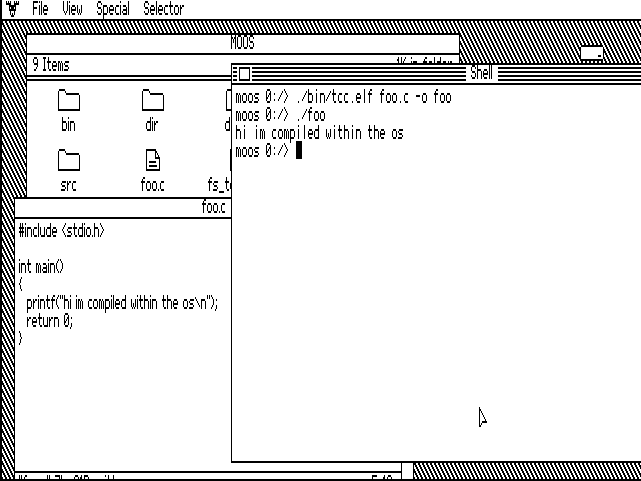
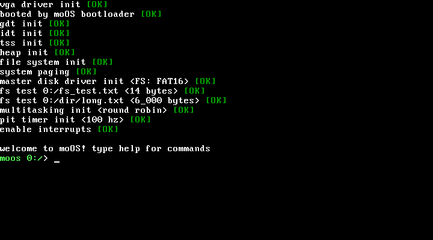
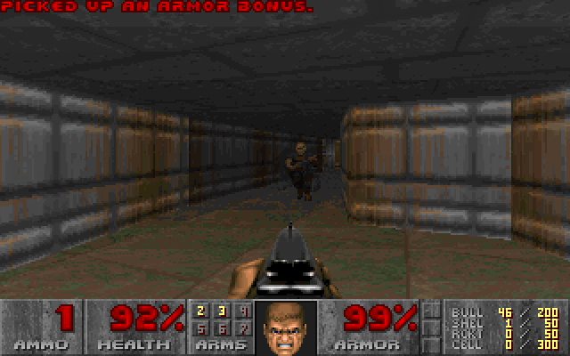
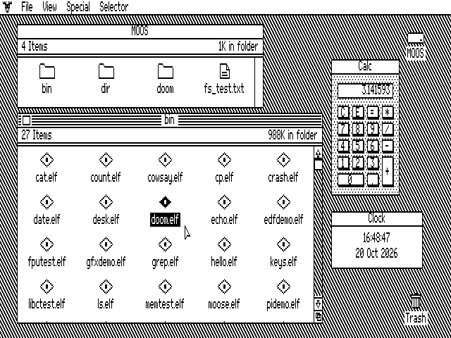
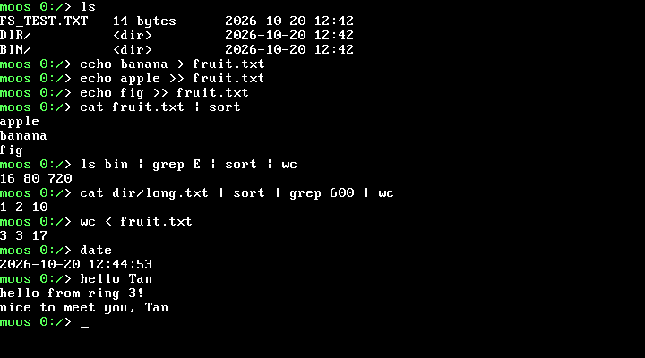
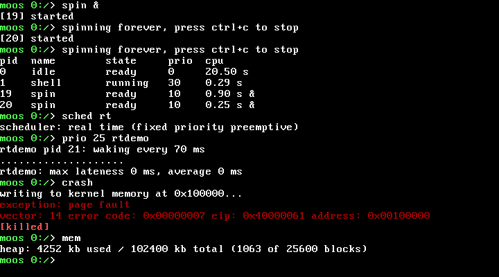
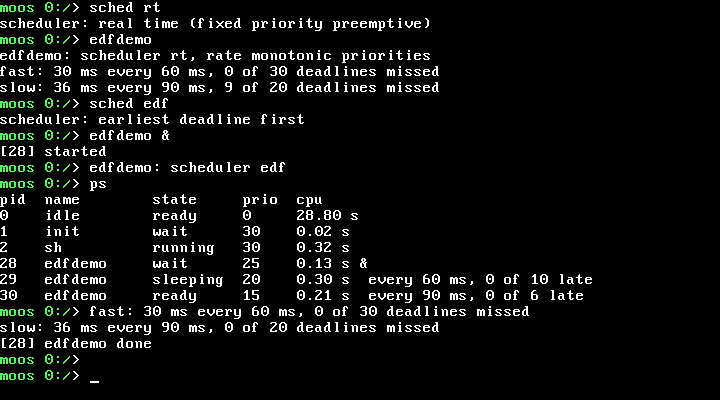
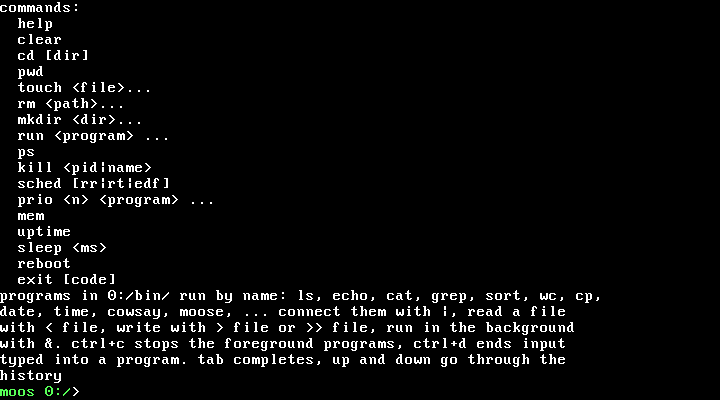
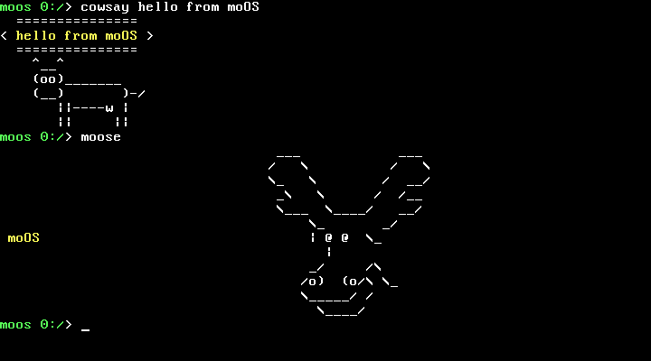
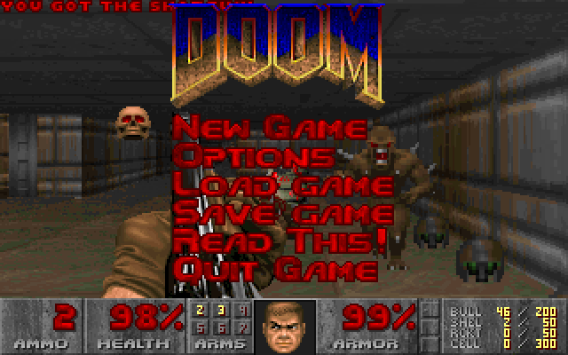

# moos

a 32-bit operating system written in c and assembly. it boots with its own
bootloader or with limine, runs preemptively scheduled ring 3 programs from a
fat16 disk with long file names and comes with a user space shell that has
pipes, redirection, job control, history and tab completion. the scheduler
does round robin, fixed priority real time with priority inheritance and
earliest deadline first. it boots into a desktop in the style of apple ii
desktop, compiles c programs on itself with tcc and it runs doom.









## features

boot
- its own two stage bootloader (fat16 boot sector, kernel in the reserved
  sectors) or limine through multiboot 1, picked at build time
- gdt and tss built in c, a20, remapped pics

kernel
- cpu exception and pic irq handling, faulting user programs are killed
  without taking down the kernel
- paging with a 64 mb address space per program (page tables allocated on
  first use), kernel pages are supervisor only and program code is read only
- kernel heap with block allocation, usage stats and invalid free detection
- preemptive multitasking with three scheduling policies, switchable at
  runtime with `sched rr` / `sched rt` / `sched edf`:
  - round robin: every task gets a 50 ms time slice in turn
  - real time: fixed priority preemptive. the highest priority ready task
    always runs and preempts lower priority tasks the moment it wakes up,
    equal priorities share the cpu round robin
  - earliest deadline first: periodic tasks run in the order of their
    deadlines, the shell still goes first
- periodic tasks (`period`, `wait_period`) that count their missed deadlines
- named mutexes shared between programs, with optional priority inheritance
  against priority inversion
- an init thread that starts the desktop at boot, then the shell once the
  desktop quits, and a new shell whenever it exits or crashes
- elf loader, `argc`/`argv`, per program heap (`sbrk`)
- x87 floating point, every task has its own fpu state
- `int 0x80` system calls for files, directories, pipes, processes, time,
  the terminal, graphics and key events. every pointer coming from user
  space is checked
- pipes, stdin/stdout/stderr and reference counted file descriptors

drivers
- vga text terminal with scrolling and a hardware cursor
- vga mode 13h graphics (320x200, 256 colours) and mode 11h (640x480,
  black and white) for one program at a time, the text screen with its font
  and palette comes back when it exits
- keyboard (us layout, shift, caps lock, ctrl, arrow keys), plus key down
  and key up events for games
- ps/2 mouse, its movement and buttons go to the program in the foreground.
  under qemu and vmware the vmmouse gives absolute positions instead
- pit timer, cmos real time clock, serial port (com1)
- ata disk reads and writes, mbr partitions

file system
- fat16: read, create, write, append, truncate, delete, `mkdir`, `rmdir`,
  directory listing, real file dates. the file allocation table is cached
  in memory. images stay valid for `fsck.fat`
- vfat long file names up to 63 chars with 8.3 aliases (`LONGFI~1.TXT`),
  case insensitive lookups and the case of short names kept
- paths relative to a working directory, `.` and `..`

shell
- a user program (`0:/bin/sh.elf`) on top of system calls, a crash in it
  cant take the kernel down
- builtins: `help`, `cd`, `pwd`, `touch`, `rm`, `mkdir`, `run`, `ps`,
  `kill`, `sched`, `prio`, `mem`, `uptime`, `sleep`, `clear`, `reboot`,
  `exit`
- pipelines (`cat notes.txt | sort | wc`), `< file`, `> file`, `>> file`, `&` and
  "quoted arguments"
- job control: `prog &` runs in the background, `ps`, `kill <pid|name>`,
  `prio <1-29> prog` sets the real time priority (default 10, the shell runs
  at 30 so a runaway program cant lock out the console). ctrl+c stops the
  foreground pipeline, ctrl+d ends input typed into a program
- line editing with the arrow keys, home, end and delete, history with
  up/down, tab completion of commands and paths

user space
- a small library on top of the system calls (`src/user/lib/moos.h`): heap,
  strings, printf, 64 bit division
- a standard c library (`src/user/libc`): stdio, scanf, stdlib, string,
  ctype, math, time, setjmp and a few posix headers, enough to build doom
  and tcc
- tcc, the tiny c compiler, runs on moOS and builds programs against that c
  library, see below

## screenshots

long file names, redirection and pipelines



a program killed by a page fault, and priority inversion with and without
priority inheritance



periodic tasks under rate monotonic priorities and earliest deadline first



the shell builtins





## getting started

requirements:
- clang (or an i686-elf-gcc cross-compiler)
- binutils (ld, objcopy)
- nasm
- qemu
- mtools, dosfstools (mkfs.fat) and util-linux (sfdisk)
- make and a host c compiler (for limine's installer)
- curl, ar and xz (the doom wad is downloaded on the first build)

limine, doomgeneric and tinycc are git submodules, clone with `--recursive`
or fetch them afterwards:
```bash
git submodule update --init
```

to run:
```bash
make run
```

### bootloaders
moos boots with its own bootloader or with [limine](https://codeberg.org/Limine/Limine),
picked at build time:
```bash
make run                      # moos bootloader (default)
make run BOOTLOADER=limine    # limine
```

| | moos bootloader | limine |
|---|---|---|
| image | `bin/os-moos.img` | `bin/os-limine.img` |
| disk layout | fat16 without a partition table, the kernel sits in its reserved sectors | mbr with one fat16 partition at 1 mb, limine's stages in the mbr and the gap after it |
| kernel | `bin/kernel.bin`, flat binary loaded to 1 mb | `/boot/moos.elf`, booted through multiboot 1 (limine's own protocol is 64 bit only) |

both use the same kernel: `bin/kernel.elf` starts with an entry stub that
works for a plain jump to 1 mb as well as for a multiboot loader, and the
disk driver finds the fat16 partition on its own. the limine config is
`src/bootloader/limine.conf`. to update limine:
```bash
git submodule update --remote external/limine
```

to build with the gcc cross-compiler instead of clang:
```bash
make CC=~/opt/cross/bin/i686-elf-gcc LD=~/opt/cross/bin/i686-elf-ld
```

### tests
the tests boot qemu headless, type commands into the shell through the qemu
monitor and check the kernel log written to qemu's debug console. afterwards
the disk image is checked with `fsck.fat` and the files moos wrote are read
back with mtools:
```bash
make test                     # moos bootloader, or the one picked above
make test-all                 # both bootloaders
```

## user programs

user programs live in `src/user/` and end up in `0:/bin` on the disk image.
type their name in the shell to run them:

| program | does |
|---|---|
| `ls [dir]...` | lists directories with sizes and dates |
| `echo <text>...` | prints its arguments |
| `cat [file]...` | prints files or stdin |
| `grep <word> [file]...` | prints lines containing a word |
| `sort [file]` | prints lines sorted |
| `wc [file]...` | counts lines, words and bytes |
| `cp <from> <to>` | copies a file |
| `date` | prints the date and time of the real time clock |
| `time <program> [args]` | runs a program and prints how long it took |
| `pipetest` | feeds `sort` through a pipe with `pipe`, `spawn` and `wait` |
| `hello [name]...` | greets you, asks for your name without arguments |
| `count` | counts to 10 using the timer |
| `rtdemo` | periodic task that measures its wakeup lateness |
| `spin` | busy loop, a cpu hog for scheduler tests |
| `memtest` | stress tests the user heap |
| `crash [code]` | writes to kernel memory (or its own code) and gets killed |
| `pidemo [nopi]` | priority inversion with and without priority inheritance |
| `edfdemo` | two periodic tasks that only edf can schedule |
| `cowsay [text]` | a cow says something |
| `moose [text]` | the moOS moose |
| `sh` | the shell, started by init once the desktop quits |
| `doom` | doom, see below |
| `desk` | a desktop in the style of apple ii desktop, started at boot, see below |
| `tcc` | the tiny c compiler, see below |
| `gfxdemo` | animated rings in vga mode 13h for 3 seconds |
| `keys` | prints key down and up events until esc |
| `fputest` | two tasks with different fpu settings at once, 64 bit division |
| `libctest` | checks the c library |

programs that read stdin when they get no file arguments work in pipelines:
```
moos 0:/> cat dir/long.txt | grep 059 | sort > found.txt
moos 0:/> wc < found.txt
11 22 110
```

to add one, create `src/user/<name>.c` with a `main (int argc, char **argv)`
and add its name to the list of user programs in the makefile. the system
calls and the small libc are in `src/user/lib/moos.h`.

### scheduler demo
`rtdemo` is a periodic task that wakes every 70 ms and reports how late its
wakeups were. run it next to cpu hogs under both policies:
```
moos 0:/> spin &
moos 0:/> spin &
moos 0:/> rtdemo
rtdemo: max lateness 90 ms, average 45 ms
moos 0:/> sched rt
moos 0:/> prio 25 rtdemo
rtdemo: max lateness 0 ms, average 0 ms
moos 0:/> kill spin
```

`pidemo` shows priority inversion. a low priority task holds a lock that a
high priority task needs while a medium priority task hogs the cpu. with
priority inheritance (the default) low runs at high's priority until it
unlocks, with `pidemo nopi` high has to wait for medium too:
```
moos 0:/> pidemo
high: got the lock after 150 ms
moos 0:/> pidemo nopi
high: got the lock after 550 ms
```

`edfdemo` runs two periodic tasks that need 90% of the cpu (30 ms every
60 ms and 36 ms every 90 ms). rate monotonic priorities cant schedule them,
earliest deadline first can:
```
moos 0:/> sched rt
moos 0:/> edfdemo
slow: 36 ms every 90 ms, 9 of 20 deadlines missed
moos 0:/> sched edf
moos 0:/> edfdemo
slow: 36 ms every 90 ms, 0 of 20 deadlines missed
```

## doom

doom is built from [doomgeneric](https://github.com/ozkl/doomgeneric) (a git
submodule) against the moOS c library, `src/user/doom.c` connects it to the
system calls. it renders 320x200 with a 256 colour palette, exactly vga mode
13h, so drawing a frame is one copy. the shareware `doom1.wad` isnt part of
the repository: the first build takes it from debian's `doom-wad-shareware`
package, checks its sha1 and copies it to `0:/doom` on the disk image.

```
moos 0:/> doom
```

| key | does |
|---|---|
| arrows | move and turn |
| ctrl | fire |
| space | open doors, use switches |
| shift | run |
| alt + arrows | strafe |
| 1 - 7 | weapons |
| tab | map |
| esc | menu, quit game is at the bottom |

quitting doom (or killing it with ctrl+c) brings back the shell. doomgeneric
doesnt save its config file, and there is no sound.



## desktop

moOS boots into `desk`, a desktop in the style of apple ii desktop
(mousedesk): a menu bar, the disk and the trash on a grey desktop and
windows you can drag, resize, scroll and close. it draws on the whole
640x480 black and white screen of vga mode 11h. in qemu (and vmware) the
kernel uses the vmmouse, which gives the position of the host pointer, so the
desktop pointer stays right under it and the window doesnt have to grab the
mouse.

- double click the disk or a folder to open it, a text file to edit it and a
  program to run it. the desktop comes back when the program exits.
  `sh.elf` opens a shell window instead
- drag a file or an empty folder to the trash to delete it
- file: open, new folder, new file (opens it in the editor), close, close
  all, get info and quit (ctrl+q)
- view: icons or a list with sizes and dates
- the moose menu has a calculator (mouse or keyboard), a clock and shell
  windows, the selector menu starts doom, gfxdemo and moose
- typing a command on the desktop (when no editor, shell window or
  calculator takes the keys) switches to the shell on the text screen with
  what you typed on its line. `exit` goes back to the desktop, its windows
  are as you left them. ctrl+q quits the desktop and init starts the shell


### shell windows

a shell window runs `sh` with its stdin and stdout on pipes, the desktop
reads what it prints (`pending` says how much a pipe holds, so it never
waits) and draws it on a terminal of 80 columns that keeps 300 lines. typing
sends the keys down the other pipe. on a stream like that the shell edits
the line at its end: history and tab completion work, the cursor keys dont
move inside the line. ctrl+c stops the programs it runs, or drops the line
at the prompt. `exit` closes the window, closing the window ends the shell
and what it runs. programs that draw graphics or read key events need the
screen and the keyboard to themselves, run those by double clicking them

### the editor

text files open in a small editor with vim's bindings (`src/user/deskedit.c`).
the title says `[+]` while there are changes that arent saved, closing the
window or quitting the desktop then asks first.

| keys | does |
|---|---|
| `h` `j` `k` `l`, arrows | move, a count before them repeats (`5j`) |
| `w` `b` `e` | next word, back a word, end of the word |
| `0` `^` `$` | start of the line, first non blank, end of the line |
| `gg` `G`, `42G` | first line, last line, line 42 |
| `i` `a` `I` `A` `o` `O` | insert mode before, after, at the start or end of the line, on a new line below or above. esc goes back |
| `x` `X` `D` `C` `J` | delete a char, the one before, to the end of the line, change to the end of the line, join lines |
| `dd` `cc` `yy`, `d` `c` `y` + motion | delete, change or yank lines or what a motion moves over (`dw`, `cw`, `d$`, `y2j`) |
| `p` `P` | put after or before the cursor, lines go below or above |
| `u` | undo the last change, again redoes it |
| `:w` `:q` `:wq` `:x` `:q!` `:42` | write, close, both, close without saving, go to line 42 |

## c compiler

[tcc](https://bellard.org/tcc/), the tiny c compiler, comes from tinycc's
`mob` branch (a git submodule, through its github mirror) and is built as
one source file against the moOS c library, `src/user/tcc/` has its
configuration and glue. it runs on moOS and makes static i386 elf programs
that moOS loads at `0x40000000`, a hello world compiles and links in about
200 ms:

```
moos 0:/> tcc /src/hello.c -o hello.elf
moos 0:/> ./hello.elf
hello from tcc, 1 args
1234567890123 / 7 = 176366841446, 6.50
```

the disk image has what it needs: the c library as `/lib/libc.a` with
`crt1.o`, its headers in `/include` (and `/include/lib/moos.h` for the
system calls, included as `"lib/moos.h"` like in `src/user`), tcc's own
headers and runtime (`libtcc1.a`) in `/lib/tcc`, and two examples in `/src`.
programs from `src/user` build on moOS unchanged, `tcc cowsay.c -o cowsay`.
together with the editor and a shell window on the desktop that is enough to
write, compile and run c without leaving moOS.

the same compiler is also built for the host as `build/tcc/i386-moos-tcc`,
it finds the disk's files in `build/sysroot` and builds `libtcc1.a`. tcc
cant `-run` programs (that needs `mmap`), and there are no shared
libraries.

## project structure
- `src/bootloader/` - boot sector, kernel entry stub and limine config
- `src/kernel/` - core os: interrupts, memory, tasks, scheduler, mutexes,
  syscalls
- `src/drivers/` - screen, keyboard, timer, clock, serial and disk drivers
- `src/file_system/` - vfs, path parser and fat16 driver
- `src/libc/` - kernel side c library
- `src/user/` - user programs including the shell and doom's glue, their
  syscall library and the c library
- `external/limine/` - limine bootloader (git submodule)
- `external/doomgeneric/` - doom (git submodule)
- `external/tinycc/` - the tiny c compiler (git submodule)
- `scripts/` - qemu test driver and helpers
- `docs/` - debugging guide and fat16 reference

## installation

### arch linux
```bash
sudo pacman -S git qemu make nasm clang mtools dosfstools util-linux curl xz
```

### fedora
```bash
sudo dnf install git qemu-system-x86-core qemu-ui-gtk make nasm clang mtools dosfstools util-linux curl xz
```

for an i686-gcc cross-compiler instead of clang, follow [this guide](https://wiki.osdev.org/GCC_Cross-Compiler)

## license
see license file for details
